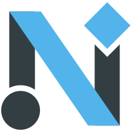
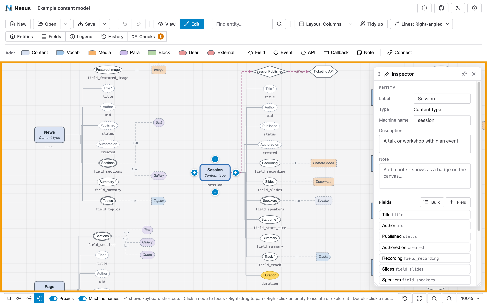

<p align="center">
  
</p>

<h1 align="center">Nexus</h1>

<div align="center">

Draw a Drupal site's content model as an interactive diagram - entirely in your browser.

[](https://github.com/drevops/nexus/issues)
[](https://github.com/drevops/nexus/pulls)
[](https://github.com/drevops/nexus/actions/workflows/test-nodejs.yml)
[](https://github.com/drevops/nexus/actions/workflows/release.yml)


[](https://scorecard.dev/viewer/?uri=github.com/drevops/nexus)
[](https://www.bestpractices.dev/projects/16651)

</div>

---

## Why

A Drupal content model has a shape of its own. Entity types hold bundles, and bundles hold fields. Some fields come with the entity type, and entity references tie bundles together with a cardinality. Teams that plan or document a Drupal site hit 2 problems:

1. **There's no established way to draw a Drupal content model.** ER diagrams, UML and whiteboards have no symbol for a bundle, a base field, a paragraph or a reference's cardinality. Each team invents a notation of its own, and the next team has to learn it.
2. **There's no easy way to build the diagram from a site that exists.** The model is spread across the site's exported configuration, 1 YAML file per bundle, field storage and field instance. Drawing it means reading those files by hand, and the drawing goes stale when the site changes.

Nexus answers both. It gives a Drupal content model 1 [visual language](docs/visual-language.md): a color and shape per entity type and a symbol per kind of field. It also reads a site's exported configuration and draws the model from it, so the diagram follows the site's own config. When the model lives in a spreadsheet, a screenshot or a spec instead, an [AI agent](#build-a-diagram-with-an-ai-agent) can write the diagram.

Nexus reads the fields of content types, vocabularies, media, paragraphs, blocks and users. It skips fields on other entity types. It draws base fields from a curated list per entity type. Review a diagram of a site with custom entity types for what it leaves out.

## What Nexus is

Nexus is a static web app. Give it a Drupal config sync directory or a module's `config/install`, and it draws the site's bundles, fields and entity references. You can also start from a [template](#templates), from scratch or from a document an AI agent wrote, then edit the model and save it as a `.nexus.json` document. **Everything runs in your browser, so your configuration never leaves it.**

**[Open the app →](https://nexus.drevops.com/)**



## Features

- **Client-side.** Nexus parses and draws in the browser, with no backend, upload or install.
- **Reads exported config.** Nexus reads only the YAML files of the folder you give it.
- **Descriptions and field settings.** Bundle descriptions, help text, default values, allowed values and translatability show in tooltips, the Inspector, the Fields table and its CSV. Tooltips and the Fields table draw basic formatting in help text and descriptions, such as `<em>` and `<strong>`, and drop scripts and other markup.
- **Shared fields.** The Fields table and its CSV count the bundles of an entity type that have each field. The field Inspector lists the other bundles with the label each one gives the field.
- **Templates.** The content models of Drupal CMS, CivicTheme, the Umami demo, Thunder and Open Social open in 1 click.
- **CSV import.** Write a content model in a spreadsheet with 1 row per field and open it as a diagram. See [Import a CSV](docs/csv-import.md).
- **Editable.** Add and change entities, fields, references and annotations, with undo and history.
- **Notes on the canvas.** A Note holds text in Markdown, anywhere on the diagram. See [Notes](docs/notes.md).
- **Field editing in the Fields table.** Click a cell to change a field's label, machine name, type, cardinality, references, help text, default value, allowed values or translatability. Tick **Req** to make a field required.
- **Hover highlight.** Rest the pointer on an entity to highlight its fields, its references and the entities at each end, and fade the rest. On a field, the highlight covers the field's own references. To turn it off, switch off **Highlight connections** on the **Hover highlight** tab of **Settings**.
- **Help in the status bar.** Rest the pointer on a control in the toolbar, a panel or the status bar, and the status bar shows its description. With no control under the pointer, the status bar shows tips for using the canvas and the keyboard shortcuts.
- **Explore from 1 entity.** Right-click an entity and pick **Explore from here**, or click **Explore from here** in its Inspector. The diagram then shows only the entities within 1 to 5 references of it. Pick the depth and the direction in the status bar: **Outward**, **Inward** or **Both**. **Clear** puts the whole diagram back where it was.
- **Checks.** The Checks panel lists the problems in the model after every edit, such as a reference with no target or a field name with 2 types. Click a problem to go to it.
- **Comparisons.** Compare the open diagram with a saved diagram or a config folder to see the bundles, fields and references each one adds, removes or changes. See [Compare 2 versions](docs/comparing.md).
- **Saved as a document.** A `.nexus.json` document holds the model and its layout, and a [JSON Schema](schema/nexus.schema.json) defines the format.
- **Exports.** PNG and SVG images of the diagram, and CSV files of its fields, bundles and references. A Markdown page documents each bundle, its fields and notes, with an optional Mermaid diagram. A standalone HTML report holds the same documentation and opens in any browser. Mermaid and Graphviz DOT text keeps the diagram in a README, a pull request or a wiki. Both draw the nodes and edges the canvas shows, in its shapes and colors. DOT keeps each node where the canvas has it, and Mermaid lays the diagram out itself. The Mermaid file uses node shapes that need Mermaid 11.3 or later. A diagram past Mermaid's 50,000-character limit gets short node ids, then loses machine names and type captions until it fits. A note at the top of the file says what changed. For a site with more than about 100 entities, pick DOT.
- **Shared as a link.** **Copy link** puts the whole diagram inside a link. See [Shared links](docs/sharing.md).
- **Built by AI agents.** An agent can write a diagram from a screenshot, a spreadsheet or a spec.

## Documentation

The [user manual](docs/README.md) covers everything you can do in Nexus, from opening your first diagram to sharing it as a link. The same manual is in the app's **Help** panel: click **?** in the toolbar, or press `?`.

## Build a diagram with an AI agent

An AI agent can turn a content model you hold in another form into a Nexus diagram. The source can be a screenshot or photo of a diagram, a spreadsheet, a Word or PDF spec or a list of content types and fields. The agent follows the `create-nexus-diagram` skill and writes a `.nexus.json` document that Nexus opens.

The site serves 3 files for agents:

- The [`create-nexus-diagram` skill](skills/create-nexus-diagram/SKILL.md), at `https://nexus.drevops.com/skills/create-nexus-diagram/SKILL.md`, maps a source onto entity types, fields and references. It includes a complete example document.
- The [JSON Schema](schema/nexus.schema.json), at `https://nexus.drevops.com/schema/nexus.schema.json`, defines the `.nexus.json` format.
- [`llms.txt`](llms.txt), at `https://nexus.drevops.com/llms.txt`, links both, so an agent given only the site's address finds them.

An agent that can read web pages, such as Claude Code, Codex or Cursor, needs only a prompt that links the skill. To keep the skill in a project for Claude Code, download it into `.claude/skills/`:

```bash
curl -sSL --create-dirs -o .claude/skills/create-nexus-diagram/SKILL.md https://nexus.drevops.com/skills/create-nexus-diagram/SKILL.md
```

To use the skill in every Claude Code project, put `SKILL.md` in `~/.claude/skills/create-nexus-diagram/` instead.

**Create with AI** in the app copies the prompt, the skill or this command for you, and opens the document the agent writes. The agent leaves the layout out, so Nexus lays the diagram out when it opens. To check a document from the command line, see [Check a diagram document](CONTRIBUTING.md#check-a-diagram-document).

## Templates

Nexus ships 5 ready-made content models:

| Template | Version | What it draws |
|----------|---------|---------------|
| [Drupal CMS](https://www.drupal.org/project/cms) | 2.2.2 | Drupal CMS with its Byte site template: a utility page, a blog post, tags and 5 media types |
| [CivicTheme](https://www.drupal.org/project/civictheme) | 1.13.0 | The government design system: 3 content types built from 31 paragraph types, plus its media types, vocabularies and blocks |
| [Umami](https://www.drupal.org/docs/umami-drupal-demonstration-installation-profile) | 11.4.12 | Drupal core's food magazine demo: articles, recipes, pages, 2 vocabularies, 5 media types and 4 block types |
| [Thunder](https://www.thunder.org) | 8.4.7 | The Drupal distribution for professional publishers: 3 content types built from 9 paragraph types, plus 7 media types, channels and tags |
| [Open Social](https://www.drupal.org/project/social) | 13.1.0 | The community and intranet distribution: topics, events, pages, albums, landing pages and courses, with 20 paragraph types, 11 vocabularies, 1 media type and 9 block types |

Each template is drawn from the configuration of an exact release. Drupal CMS builds its landing pages with Canvas, so its diagram has no landing page content type. Umami ships with Drupal core, so its version is the core release it comes from. Open Social keeps groups, profiles and posts in entity types that Nexus doesn't draw, so the diagram leaves out their fields. A field that references a group points to a placeholder entity.

## Privacy

Nexus has no backend. The configuration you import and the diagrams you build stay in your browser's memory. They leave it only when you save or export a file, or copy a link, which carries the diagram inside it. Your preferences, such as the theme, the panel layout and the entity colors, stay in the browser's `localStorage`.

Nexus is provided as is, without warranty of any kind, and the authors accept no responsibility or liability for any data you load into it or create with it.

## Security

Nexus opens files from anywhere: config folders, `.nexus.json` documents, links and replies pasted into **Create with AI**. It reads each one as data and runs none of it:

- Text from a file is drawn as text, so markup in a label shows as written.
- An entity type's color must be a 6- or 8-digit hex value, its symbol 1 of the listed shapes and its name a machine name. Any other value falls back to the default. The same checks apply to the settings stored in your browser.
- A Content Security Policy in `index.html` lets the page run only its own scripts and fetch only its own files and the `data:` icons Shoelace draws.

The page sets no cookies and keeps only your preferences in `localStorage` (see [Privacy](#privacy)).

Each library in `assets/vendor/` is the published npm build that [`vendor.json`](vendor.json) names, byte for byte. CI checks the files against npm on every run.

[`SECURITY.md`](SECURITY.md) explains how to report a vulnerability and how to verify a release.

## Contributing

See [`CONTRIBUTING.md`](CONTRIBUTING.md) to run Nexus locally, run the tests, host your own copy or check a diagram document.

## License

Nexus is free software, released under the [GNU General Public License, version 2 or later](LICENSE) (GPL-2.0-or-later), matching the Drupal ecosystem it serves. CivicTheme, Drupal CMS, Drupal core's Umami demo, Thunder and Open Social, which the templates draw, are released under the same license.

---
_This repository was created using the [Scaffold](https://getscaffold.dev/) project template_
