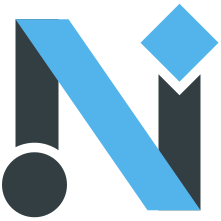
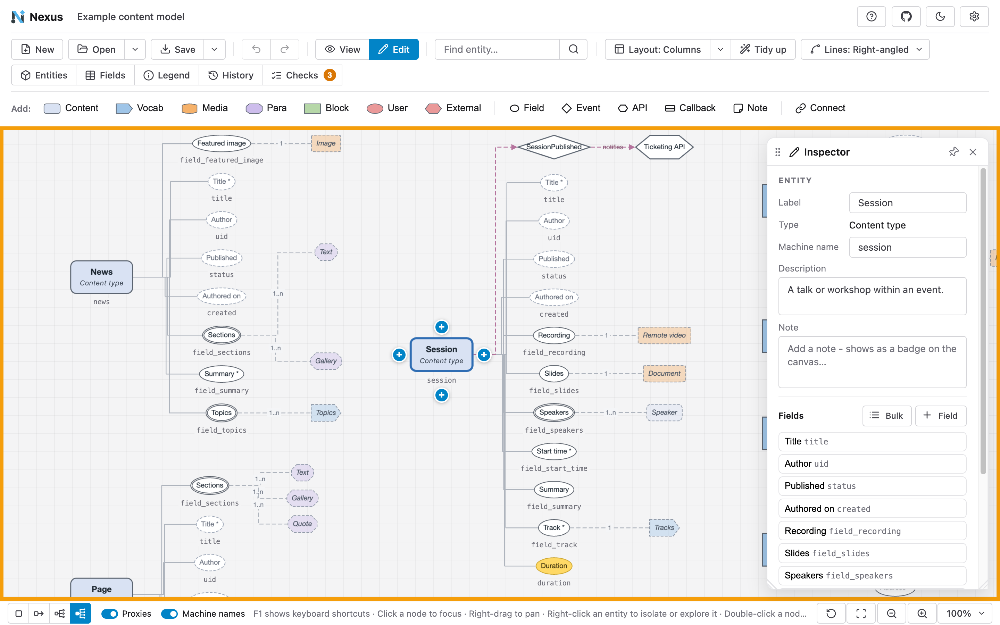

<p align="center">
  
</p>

<h1 align="center">Nexus</h1>

<div align="center">

Draw a Drupal site's content model as an interactive diagram - entirely in your browser.

[](https://github.com/drevops/nexus/issues)
[](https://github.com/drevops/nexus/pulls)
[](https://github.com/drevops/nexus/actions/workflows/test-nodejs.yml)
[](https://github.com/drevops/nexus/actions/workflows/release.yml)


[](https://scorecard.dev/viewer/?uri=github.com/drevops/nexus)
[](https://www.bestpractices.dev/projects/16651)

</div>

---

## Why

A Drupal content model has a shape of its own. Entity types hold bundles, and bundles hold fields. Some fields come with the entity type, and entity references tie bundles together with a cardinality. Teams that plan or document a Drupal site hit 2 problems:

1. **There's no established way to draw a Drupal content model.** ER diagrams, UML and whiteboards have no symbol for a bundle, a base field, a paragraph or a reference's cardinality. Each team invents a notation of its own, and the next team has to learn it.
2. **There's no easy way to build the diagram from a site that exists.** The model is spread across the site's exported configuration, 1 YAML file per bundle, field storage and field instance. Drawing it means reading those files by hand, and the drawing goes stale when the site changes.

Nexus answers both. It gives a Drupal content model 1 [visual language](#the-visual-language): a color and shape per entity type and a symbol per kind of field. It also reads a site's exported configuration and draws the model from it, so the diagram follows the site's own config. When the model lives in a spreadsheet, a screenshot or a spec instead, an [AI agent](#build-a-diagram-with-an-ai-agent) can write the diagram.

Nexus reads the fields of content types, vocabularies, media, paragraphs, blocks and users. It skips fields on other entity types. It draws base fields from a curated list per entity type. Review a diagram of a site with custom entity types for what it leaves out.

## What Nexus is

Nexus is a static web app. Give it a Drupal config sync directory or a module's `config/install`, and it draws the site's bundles, fields and entity references. You can also start from a [template](#templates), from scratch or from a document an AI agent wrote, then edit the model and save it as a `.nexus.json` document. **Everything runs in your browser, so your configuration never leaves it.**

**[Open the app →](https://nexus.drevops.com/)**



## Features

- **Client-side.** Nexus parses and draws in the browser, with no backend, upload or install.
- **Reads exported config.** Nexus reads only the YAML files of the folder you give it.
- **Descriptions and field settings.** Bundle descriptions, help text, default values, allowed values and translatability show in tooltips, the Inspector, the Fields table and its CSV.
- **Templates.** The content models of Drupal CMS and CivicTheme open in 1 click.
- **Editable.** Add and change entities, fields, references and annotations, with undo and history.
- **Saved as a document.** A `.nexus.json` document holds the model and its layout, and a [JSON Schema](schema/nexus.schema.json) defines the format.
- **Exports.** PNG and SVG images of the diagram, a CSV of its fields and a Markdown page that documents each bundle, its fields and notes, with an optional Mermaid diagram.
- **Built by AI agents.** An agent can write a diagram from a screenshot, a spreadsheet or a spec.

## Build a diagram with an AI agent

An AI agent can turn a content model you hold in another form into a Nexus diagram. The source can be a screenshot or photo of a diagram, a spreadsheet, a Word or PDF spec or a list of content types and fields. The agent follows the `create-nexus-diagram` skill and writes a `.nexus.json` document that Nexus opens.

The site serves 3 files for agents:

- The [`create-nexus-diagram` skill](skills/create-nexus-diagram/SKILL.md), at `https://nexus.drevops.com/skills/create-nexus-diagram/SKILL.md`, maps a source onto entity types, fields and references. It includes a complete example document.
- The [JSON Schema](schema/nexus.schema.json), at `https://nexus.drevops.com/schema/nexus.schema.json`, defines the `.nexus.json` format.
- [`llms.txt`](llms.txt), at `https://nexus.drevops.com/llms.txt`, links both, so an agent given only the site's address finds them.

An agent that can read web pages, such as Claude Code, Codex or Cursor, needs only a prompt that links the skill. To keep the skill in a project for Claude Code, download it into `.claude/skills/`:

```bash
curl -sSL --create-dirs -o .claude/skills/create-nexus-diagram/SKILL.md https://nexus.drevops.com/skills/create-nexus-diagram/SKILL.md
```

To use the skill in every Claude Code project, put `SKILL.md` in `~/.claude/skills/create-nexus-diagram/` instead.

**Create with AI** in the app copies the prompt, the skill or this command for you, and opens the document the agent writes. The agent leaves the layout out, so Nexus lays the diagram out when it opens. To check a document from the command line, see [Check a diagram document](CONTRIBUTING.md#check-a-diagram-document).

## Templates

Nexus ships 2 ready-made content models:

| Template | Version | What it draws |
|----------|---------|---------------|
| [Drupal CMS](https://www.drupal.org/project/cms) | 2.2.2 | Drupal CMS with its Byte site template: a utility page, a blog post, tags and 5 media types |
| [CivicTheme](https://www.drupal.org/project/civictheme) | 1.13.0 | The government design system: 3 content types built from 31 paragraph types, plus its media types, vocabularies and blocks |

Each template is drawn from the configuration of an exact release. Drupal CMS builds its landing pages with Canvas, so its diagram has no landing page content type.

## The visual language

Nexus draws entities, fields and references from configuration. Events, APIs, callbacks and calculated fields come from an [annotation overlay](#annotation-overlay).

| Symbol | Meaning | Source |
|--------|---------|--------|
| Colored shape, set per entity type | An entity bundle - content type, vocabulary, media, paragraph, block, user or external entity | Config |
| Faded copy of an entity, dashed border | A proxy: a reference's target, drawn beside the field that references it | Config |
| Ellipse, solid border | Single-value field | Config |
| Ellipse, double border | Multi-value field | Config |
| Ellipse, dashed border | System (base) field | Curated per entity type |
| Ellipse, yellow fill | Calculated field | Annotation |
| Diamond | Event | Annotation |
| Hexagon | API | Annotation |
| Rounded rectangle with a method | Callback | Annotation |

Content types are rounded rectangles, vocabularies are tags, media are barrels, paragraphs are cut rectangles, blocks are rectangles, users are ellipses and external entities are hexagons. A field label ending in `*` marks a required field. A reference arrow carries the field's cardinality: `1`, `1..N` for a limit of N or `1..n` for unlimited.

## Annotation overlay

An annotation overlay draws the parts of a site that Drupal configuration leaves out, such as domain events, external APIs and integration callbacks. It's a YAML file named `annotations.yml` or `nexus.annotations.yml`, anywhere in the config folder you import. Nexus reads 1 overlay per import, so keep 1 in the folder. This one describes a conference site:

```yaml
title: 'Example content model'
nodes:
  - id: ticketing_api
    kind: api
    label: 'Ticketing API'
  - id: sync_registrations
    kind: callback
    label: 'Sync registrations'
    method: POST
    attach: node.event
  - id: session_published
    kind: event
    label: SessionPublished
    attach: node.session
edges:
  - { from: session_published, to: ticketing_api, label: notifies }
computed_fields:
  node.session:
    - { name: duration, label: 'Duration' }
```

Every key is optional. The following table lists what each key draws:

| Key | What it draws |
|-----|---------------|
| `title` | The diagram's title, in place of `Content model` |
| `nodes` | 1 Event, API or Callback node per item |
| `nodes[].id` | The node's id, which `attach` and `edges` refer to. An item without an `id` draws nothing |
| `nodes[].kind` | The node's symbol: `event` (diamond), `api` (hexagon) or `callback` (rounded rectangle). A missing or unknown kind draws an Event |
| `nodes[].label` | The text in the node. Defaults to its `id` |
| `nodes[].attach` | An edge to the node from the node with this id, such as `node.event` |
| `nodes[].method` | A second line of text in the node, such as an HTTP verb |
| `nodes[].note` | A note badge that shows this text |
| `edges` | 1 edge between 2 nodes per item |
| `edges[].from`, `edges[].to` | The ids of the edge's start and end nodes. An item without both draws nothing |
| `edges[].label` | The text on the edge. Defaults to none |
| `computed_fields` | Calculated fields, listed under the id of the entity they belong to, such as `node.session` |
| `computed_fields.<id>[].name` | The field's machine name. An item without a `name` draws nothing |
| `computed_fields.<id>[].label` | The field's label. Defaults to its `name` |

`attach`, `edges` and `computed_fields` find nodes by id:

- An entity's id is its entity type and bundle, joined by a dot: `node.session`.
- A field's id is `field:`, its entity's id, a colon and the field's machine name: `field:node.session:field_speakers`.
- An annotation's id is the `id` it's given in `nodes`. Give each annotation an `id` that no other node has.

An `attach`, an edge or a `computed_fields` entry that names an id the diagram doesn't have draws nothing. `computed_fields` takes entity ids only.

## Privacy

Nexus has no backend. The configuration you import and the diagrams you build stay in your browser's memory. They leave it only when you save or export a file. Your preferences, such as the theme, the panel layout and the entity colors, stay in the browser's `localStorage`.

Nexus is provided as is, without warranty of any kind, and the authors accept no responsibility or liability for any data you load into it or create with it.

## Security

Nexus opens files from anywhere: config folders, `.nexus.json` documents and replies pasted into **Create with AI**. It reads each one as data and runs none of it:

- Text from a file is drawn as text, so markup in a label shows as written.
- An entity type's color must be a 6- or 8-digit hex value, its symbol 1 of the listed shapes and its name a machine name. Any other value falls back to the default. The same checks apply to the settings stored in your browser.
- A Content Security Policy in `index.html` lets the page run only its own scripts and fetch only its own files and the `data:` icons Shoelace draws.

The page sets no cookies and keeps only your preferences in `localStorage` (see [Privacy](#privacy)).

Each library in `assets/vendor/` is the published npm build that [`vendor.json`](vendor.json) names, byte for byte. CI checks the files against npm on every run.

[`SECURITY.md`](SECURITY.md) explains how to report a vulnerability and how to verify a release.

## Contributing

See [`CONTRIBUTING.md`](CONTRIBUTING.md) to run Nexus locally, run the tests, host your own copy or check a diagram document.

## License

Nexus is free software, released under the [GNU General Public License, version 2 or later](LICENSE) (GPL-2.0-or-later), matching the Drupal ecosystem it serves. CivicTheme and Drupal CMS, which the templates draw, are released under the same license.

---
_This repository was created using the [Scaffold](https://getscaffold.dev/) project template_
