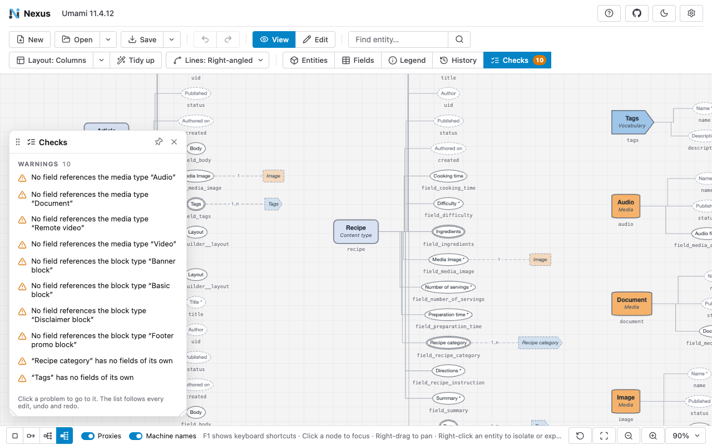

# Checks

The **Checks** panel lists the problems in the open model, such as a reference with no target or a field name with 2 types, and takes you to each one. Nexus checks the model again after every change, so the list always matches the diagram.

## Open the panel

Click **Checks** in the toolbar, or press `5`. The **Checks** button carries a badge with the number of problems, in red when at least 1 is an error and in amber when all are warnings. The badge hides when the model has no problems. [Getting started](getting-started.md#arrange-the-panels) explains how to move, dock and resize a panel.

## Read the problems

The panel groups the problems in 2 levels, errors first:

- **Errors** are problems Drupal would reject.
- **Warnings** are problems that break common practice.

Each problem names the bundle or field it's on. When the model has none, the panel reads **No problems found.**

## What Nexus checks

The following table lists each rule:

| Rule | Level |
|------|-------|
| Reference with no target, or a target the model doesn't have | Error |
| Field name with a different type or cardinality on 2 bundles of 1 entity type | Error |
| Machine name that breaks Drupal's pattern or length limit | Error |
| 2 fields on 1 bundle with the same label | Warning |
| Paragraph, media or block type no field references | Warning |
| Bundle with no fields of its own | Warning |
| List field with no allowed values | Warning |
| Bundle with more fields than the field limit | Warning |

Drupal's machine name pattern allows lowercase letters, digits and underscores, up to 32 characters. The field limit is 30 by default. Set it from 1 to 999 on the **Checks** tab of [Settings](settings.md#checks).

Base fields need no reference target and have no storage of their own, so the target, storage and field limit rules skip them. The `*` bundle, which stands for every bundle of its type, has no rules of its own.

## Go to a problem

Click a problem to center its field or bundle on the canvas. In Edit mode, the [Inspector](inspector.md) opens on it too, so you can fix it straight away.

A problem on an entity type you've hidden in the [Entities panel](entities-panel.md), or outside the [explore view](explore.md), can't be reached. Its row is off, and its title says what to change.
