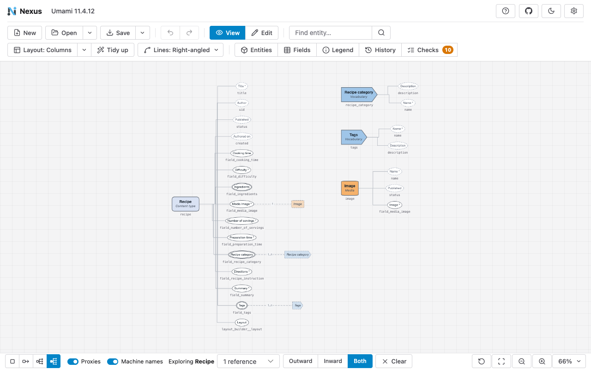

# Explore from an entity

The explore view shows 1 entity and the entities within a few references of it, and hides the rest of the diagram. Use it to study 1 corner of a large model, then clear it to get your whole diagram back exactly as it was.

## Start exploring

Start the explore view in either of these ways:

- Right-click an entity on the canvas, then click **Explore from here**.
- In Edit mode, select an entity and click **Explore from here** in the [Inspector](inspector.md).

Nexus hides every entity outside the view, lays out the rest and centers it at 100%. Click **Fit to view** (`Shift`+`1`) to see all of it at once. The tips in the status bar give way to the explore bar, which starts with **Exploring** and the entity's name.

## Pick the depth and direction

The explore bar has 2 controls:

- The depth list sets how many references away the view reaches, from **1 reference** to **5 references**.
- The direction buttons set which references the view follows.

| Direction | What the view shows |
|-----------|---------------------|
| **Outward** | The entities this one references, and the entities those reference in turn |
| **Inward** | The entities that reference this one, and the entities that reference those in turn |
| **Both** | The entities linked to this one by references either way |

The first view starts at **1 reference** and **Both**. Each view after it starts with the depth and direction you last picked, until you reload the page.

The view follows every reference, including those of hidden fields and of entity types the [Entities panel](entities-panel.md) hides. Fields show with their entity, and annotations show when they're attached to something in the view. A node you create while exploring stays in the view.

## Clear the view

Click **Clear** in the explore bar to show the whole diagram again. Nexus puts every node back where it was and returns to the zoom and position you had before. If you changed the detail level, the **Proxies** switch or an entity type filter while exploring, Nexus runs the layout again instead. The explore view adds no step to the [history](history.md).

The view also ends when you undo, redo or jump to a version in the History panel, delete the entity it started from, open another diagram or start a [comparison](comparing.md).

## Save and export while exploring

Saving, **Copy link**, the Markdown and HTML exports and the CSV files all use the whole diagram, with its own layout. The PNG, SVG, Mermaid and DOT exports draw what the canvas shows, so they draw the explore view. See [Exporting](exporting.md).
