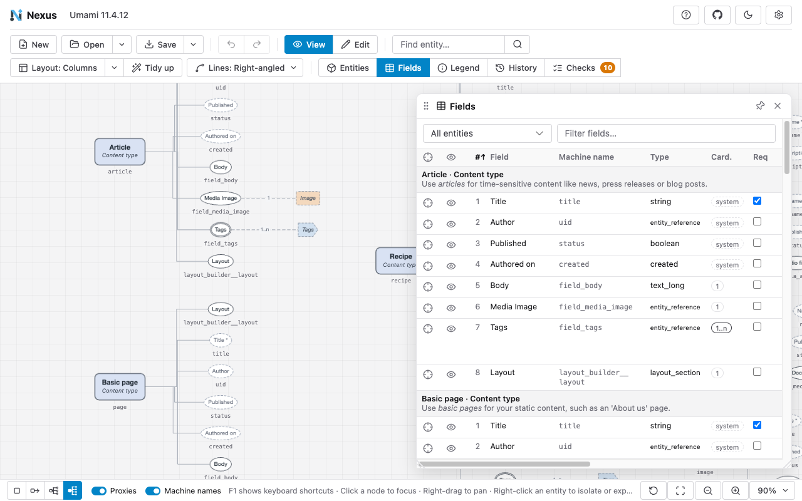

# Fields table

The **Fields** panel lists every field of the diagram in a table, grouped by entity, and lets you edit most of a field's settings in place. Use it to review a model field by field, sort and filter it, and hide fields from the canvas.

## Open the table

Click **Fields** in the toolbar, or press `2`. To open it on 1 entity's fields, click **fields** beside the entity in the [Entities panel](entities-panel.md). The table is a wide panel that scrolls both ways. [Getting started](getting-started.md#arrange-the-panels) explains how to move, dock and resize it.

## Filter the rows

The bar at the top of the panel has 2 filters:

- The entity list shows **All entities** or the fields of 1 entity.
- **Filter fields…** keeps the fields whose entity, label, machine name, type, reference targets or help text contain what you type.

The filters and the sort stay as they are when you dock, undock or close the panel.

## Read the columns

Each entity starts a group with its label, its entity type and its description. Each field row starts with a crosshair button and an eye button, then these columns:

| Column | What it shows |
|--------|---------------|
| **#** | The field's place in its entity |
| **Field** | The field's label |
| **Machine name** | The name the field is stored under |
| **Type** | The field type |
| **Card.** | The cardinality, `1`, `1..N` or `1..n`, or a `system` or `calculated` badge for a base or calculated field |
| **Req** | A tick when the field is required |
| **Refs** | The entities a reference field points to. Click 1 to find it on the canvas |
| **Used in** | How many bundles of the entity type have a field with this machine name. Rest the pointer on the number to see their names |
| **Help text** | The text editors see under the field |
| **Default** | The value a new item starts with |
| **Allowed values** | The values a list field offers, or `From name()` when a PHP function, `allowed_values_function`, provides them |
| **Transl.** | ✓ when the field is translatable, ✕ when it isn't and blank when the source doesn't say |

**Help text**, **Default**, **Allowed values** and **Transl.** show in Edit mode, and in View mode while any field of the diagram has 1 of those settings. Help text and descriptions show basic formatting, such as bold and lists, and a link shows its address when you rest the pointer on it. Base and calculated fields leave **Used in** blank.

## Sort the rows

Click a column's header to sort by it. The first click sorts in ascending order, the second in descending order and the third goes back to the **#** order. The fields stay grouped by entity, blank cells come last and fields with the same value keep their **#** order.

## Go to a field

Click the crosshair button at the start of a row to center the field on the canvas and highlight it with its entity and references. When the canvas hides the field, the button is off. Rest the pointer on it to read what to change:

- The field is hidden. Show it with the eye button.
- The [detail level](navigating.md#detail-levels) leaves it out. The title names the level that shows it.
- Its entity type is hidden in the [Entities panel](entities-panel.md).
- The [explore view](explore.md) leaves out its entity.

## Hide a field

Click the eye button in a row to hide the field and its references on the canvas, and click it again to show them. The row stays in the table, dimmed.

A hidden field is part of the model: hiding it is a step in the [history](history.md), and a saved diagram and a link keep it hidden. When a layout runs, a hidden field moves with its entity, so it shows up beside the entity again.

## Editing a cell

You can edit a field in the table in either mode. Click a cell to open its editor:

- **Field**, **Machine name** and **Default** open a text box. Press `Enter` or click elsewhere to save, and press `Escape` to cancel.
- **Help text** and **Allowed values** open a box of several lines. Press `Shift`+`Enter` to start a new line. Write allowed values 1 per line as `value|label`, such as `draft|Draft`.
- **Type**, **Card.** and **Transl.** open a list. Pick a value, or press `Escape` to cancel. To mark a field's translatability as unknown, click the **×** in the **Transl.** list.
- **Refs** has a pencil button that opens a list of entities. Each entity you pick or unpick saves straight away. Press `Escape` to close the list.
- **Req** is a checkbox. Tick it to make the field required.

Some cells can't be edited. **Card.** stays fixed for base and calculated fields, **Refs** opens only for reference fields and **Allowed values** opens only for `list_*` fields or fields that already have values.

Each edit is 1 step in the [history](history.md). An edit to the field the Inspector shows, or to its entity, updates the Inspector too. The editors are off while you [compare 2 versions](comparing.md).

## Save the table as CSV

To save the table as a spreadsheet, click the caret beside **Save**, then **CSV** > **Fields**. The CSV keeps the diagram's order and every column, whatever the filters and the sort. See [Exporting](exporting.md#csv).
