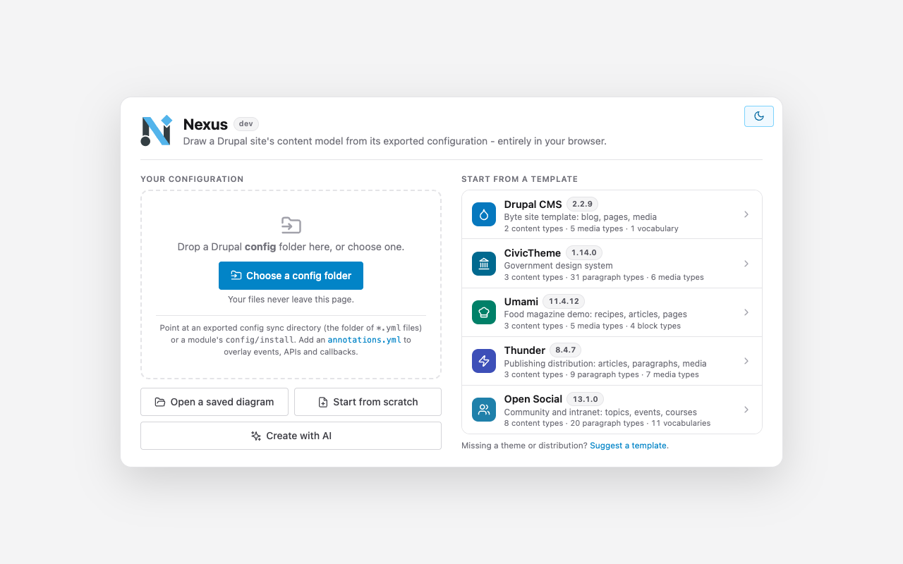
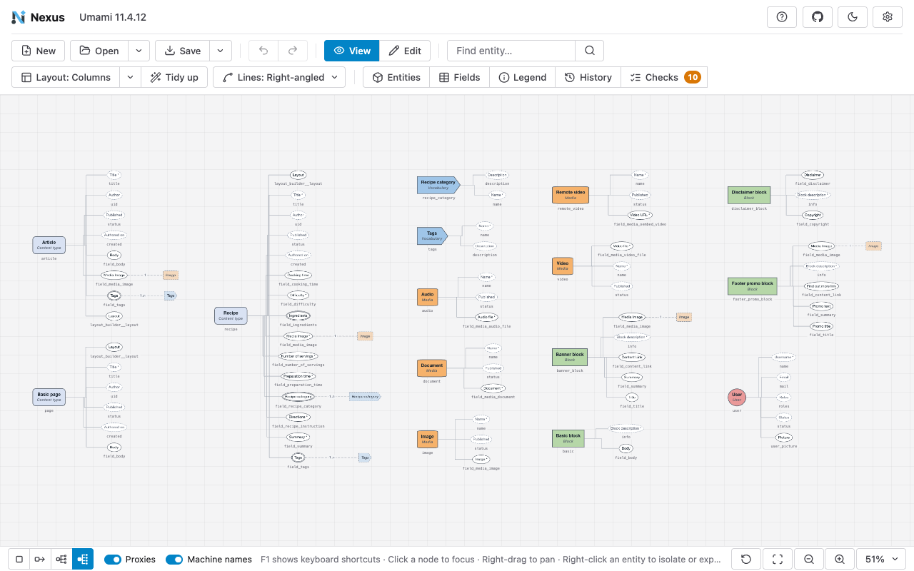

# Getting started

Nexus draws a Drupal site's content model as a diagram that you can explore, edit and share, and everything runs in your browser. Follow this page to open your first diagram and find your way around the screen.

## Open your first diagram

Nexus opens on the landing screen. Its left column, **Your configuration**, takes your own files, and its right column, **Start from a template**, lists ready-made content models.

Pick 1 of these ways to open a diagram:

- To draw your site's model, drop its config folder on the dropzone, or click **Choose a config folder** (`Alt`+`I`). Point Nexus at an exported config sync directory, the folder of `*.yml` files, or at a module's `config/install`.
- To try Nexus on a real model, click a template row, or press its number from `1` to `5`. [Templates](templates.md) describes each one.
- To reopen a diagram you saved, click **Open a saved diagram** (`Ctrl`+`O`, or `Cmd`+`O` on a Mac).
- To start with an empty canvas, click **Start from scratch** (`Alt`+`N`).
- To have an AI agent write the diagram from a screenshot, spreadsheet or spec, click **Create with AI** (`Alt`+`A`). See [Create with AI](create-with-ai.md).
- To open a spreadsheet of fields, drop a `.csv` file on the dropzone. See [Import a CSV](csv-import.md).

Nexus reads the fields of content types, vocabularies, media, paragraphs, blocks and users. It skips fields on other entity types, and it adds the base fields from a curated list per entity type. A folder with no YAML files, or with no bundles Nexus can draw, shows an error at the foot of the landing screen and opens nothing.

To come back to the landing screen later, click the caret beside **Open**, then **Config folder or template…**. While a diagram is open behind it, the landing screen has a **×** button in its top-right corner that returns you to the diagram. `Escape` does the same.

## Find your way around

The screen has 3 parts: the toolbar at the top, the canvas in the middle and the status bar at the bottom.

The top line of the toolbar holds the diagram's name on the left and 4 buttons on the right:

- **Help** (`?`) opens this manual.
- The GitHub button opens the Nexus repository.
- The moon or sun button (`D`) switches the theme.
- The cog button (`,`) opens **Settings**.

The rows below it hold the tools, in these groups:

| Group | Controls | Read more |
|-------|----------|-----------|
| Files | **New**, **Open**, **Save** | [Saving and opening](saving.md), [Exporting](exporting.md) |
| History | **Undo**, **Redo** | [History](history.md) |
| Mode | **View**, **Edit** | [View and Edit modes](view-and-edit.md) |
| Find | **Find entity…** | [Moving around the canvas](navigating.md#find-an-entity) |
| Layout | **Layout**, **Tidy up**, **Lines** | [Layouts and lines](layouts.md) |
| Panels | **Entities**, **Fields**, **Legend**, **History**, **Checks** | [Entities panel](entities-panel.md), [Fields table](fields-table.md), [Legend](legend.md), [History](history.md), [Checks](checks.md) |

In Edit mode, another row, the **Add** bar, holds the tools that create entities, fields and annotations. See [Building a model](building.md).

The status bar holds the detail level buttons and the **Proxies** and **Machine names** switches on the left, and the zoom controls on the right. See [Moving around the canvas](navigating.md). Between them, the status bar describes the control under the pointer, or shows tips when the pointer rests on nothing.

## Name your diagram

The field beside the **Nexus** mark holds the diagram's name. Click it and type to rename the diagram. Nexus shows the name in the browser tab and names every file you save after it, in lowercase with hyphens, so a diagram named `Umami 11.4.12` saves as `umami-11-4-12.nexus.json`.

## Start a new diagram

Click **New** (`Alt`+`N`) to replace the open diagram with an empty one named `New content model`. **New** doesn't ask first, and the history starts over, so save the open diagram before you click it.

## Arrange the panels

Panels show lists and forms beside the diagram. Each panel opens from its toolbar button or its number key, `1` to `5`, and closes with that button again or with the **×** in its header. The [Inspector](inspector.md) opens on its own when you select a node in Edit mode.

A panel floats over the canvas until you dock it:

- To move a floating panel, drag its header.
- To dock a panel, drop it within about 90 pixels of the canvas's left or right edge, or click the pin in its header. The pin docks the panel on the side of the canvas the panel is closer to.
- To move a docked panel up or down its side, or to the other side, drag the grip handle before its title.
- To undock a panel, drag its header away from the side, or click its pin again.
- To resize a floating panel, drag its left, right or bottom edge or a bottom corner. Double-click any of those handles to fit the panel to its content again.
- To resize a docked panel, drag its bottom edge for its height, or drag the inner edge of the side rail for the rail's width.

A click on a panel brings it to the front. Nexus remembers the panels' places in your browser, and a saved diagram stores them too.

## Switch the theme

Click the moon or sun button (`D`) to switch between the light and dark themes. On your first visit, Nexus follows your system's theme, and after that it remembers your choice.

## Getting help

Click **Help** in the toolbar, or press `?`, to open the **Help** panel. It holds this manual: a wide panel with the contents on the left and a search box above them. Each of the other panels, and the **Settings**, **Copy link** and **Create with AI** dialogs, has a **?** button that opens the manual at the page about it. **About Nexus**, with the version and the license, opens from the foot of the contents.

Press `F1` to label every control on screen with its keyboard shortcut. See [Keyboard shortcuts](keyboard-shortcuts.md).

## Where to next

- [View and Edit modes](view-and-edit.md) explains what a click, a drag and a right-click do.
- [The visual language](visual-language.md) explains each shape and line on the canvas.
- [Building a model](building.md) shows how to add entities, fields and references.
