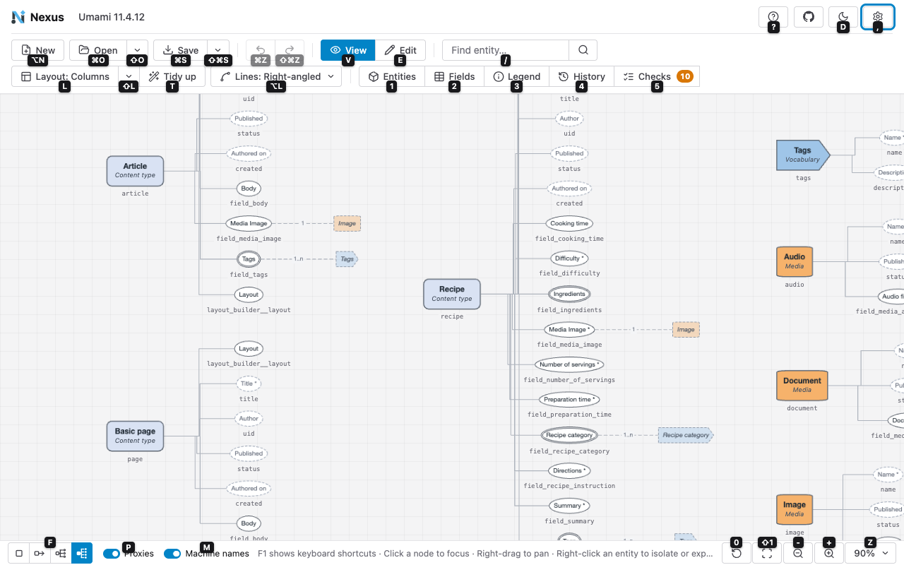

# Keyboard shortcuts

Every button in the toolbar, the **Add** bar and the status bar has a keyboard shortcut. This page lists them all and explains when they run.

## See the shortcuts on screen

Press `F1` to label every control on screen with its shortcut. The labels use your platform's keys, such as `⌘S` on a Mac and `Ctrl+S` elsewhere. Press `F1` again, press `Escape`, click anywhere or use any shortcut to hide them.

## When shortcuts run

A shortcut runs only while its control is on screen. The **Add** bar shortcuts work in Edit mode, the template numbers on the landing screen and **Changes** (`6`) during a comparison. No shortcut runs while a dialog is open.

While you type in a text box, single keys type text, so only shortcuts with `Ctrl` or `Cmd` run, and `Ctrl`+`Z` and `Ctrl`+`Y` undo and redo your typing. In a list or a menu, only shortcuts with `Ctrl`, `Cmd` or `Alt` run.

A shortcut for a text box, such as `/` for **Find entity…**, moves the focus to the box and selects its text.

## Landing screen

| Action | Windows and Linux | Mac |
|--------|-------------------|-----|
| Choose a config folder | `Alt`+`I` | `Option`+`I` |
| Open a saved diagram | `Ctrl`+`O` | `Cmd`+`O` |
| Start from scratch | `Alt`+`N` | `Option`+`N` |
| Create with AI | `Alt`+`A` | `Option`+`A` |
| Open the template in that row | `1` to `5` | `1` to `5` |
| Switch the theme | `D` | `D` |
| Close the landing screen and return to the open diagram | `Escape` | `Escape` |

## Toolbar

| Action | Windows and Linux | Mac |
|--------|-------------------|-----|
| Open the **Help** panel | `?` | `?` |
| Switch the theme | `D` | `D` |
| Open **Settings** | `,` | `,` |
| New diagram | `Alt`+`N` | `Option`+`N` |
| Open a saved diagram | `Ctrl`+`O` | `Cmd`+`O` |
| Open the **Open** menu | `Shift`+`O` | `Shift`+`O` |
| Save | `Ctrl`+`S` | `Cmd`+`S` |
| Open the **Save as** menu | `Ctrl`+`Shift`+`S` | `Cmd`+`Shift`+`S` |
| Undo | `Ctrl`+`Z` | `Cmd`+`Z` |
| Redo | `Ctrl`+`Shift`+`Z` or `Ctrl`+`Y` | `Cmd`+`Shift`+`Z` or `Ctrl`+`Y` |
| View mode | `V` | `V` |
| Edit mode | `E` | `E` |
| Find entity | `/` | `/` |
| Run the layout again | `L` | `L` |
| Open the **Layout** menu | `Shift`+`L` | `Shift`+`L` |
| Tidy up | `T` | `T` |
| Open the **Lines** menu | `Alt`+`L` | `Option`+`L` |
| **Entities** panel | `1` | `1` |
| **Fields** panel | `2` | `2` |
| **Legend** panel | `3` | `3` |
| **History** panel | `4` | `4` |
| **Checks** panel | `5` | `5` |
| **Changes** panel | `6` | `6` |

Hold the undo or redo keys down to step through several changes. The zoom keys in the status bar repeat the same way.

## Add bar

These shortcuts work in Edit mode:

| Action | Shortcut |
|--------|----------|
| Add a content type | `Shift`+`C` |
| Add a vocabulary | `Shift`+`V` |
| Add a media type | `Shift`+`M` |
| Add a paragraph type | `Shift`+`P` |
| Add a block type | `Shift`+`B` |
| Add a user entity | `Shift`+`U` |
| Add an external entity | `Shift`+`X` |
| Add a field | `Shift`+`F` |
| Place an event | `Shift`+`E` |
| Place an API | `Shift`+`A` |
| Place a callback | `Shift`+`K` |
| Place a Note | `Shift`+`N` |
| Turn **Connect** on or off | `C` |
| Delete the selected entities, fields and annotations | `Delete` or `Backspace` |

## Status bar

| Action | Windows and Linux | Mac |
|--------|-------------------|-----|
| Step to the next detail level | `F` | `F` |
| **Proxies** on or off | `P` | `P` |
| **Machine names** on or off | `M` | `M` |
| Reset the view to 100% | `0` or `Ctrl`+`0` | `0` or `Cmd`+`0` |
| Fit the whole diagram in view | `Shift`+`1` | `Shift`+`1` |
| Zoom out | `-` or `Ctrl`+`-` | `-` or `Cmd`+`-` |
| Zoom in | `+`, `=` or `Ctrl`+`+` | `+`, `=` or `Cmd`+`+` |
| Open the zoom level menu | `Z` | `Z` |

Your browser's zoom keys zoom the diagram, so the toolbar and panels stay the same size.

## Panels and editors

| Action | Shortcut |
|--------|----------|
| Save a cell of the [Fields table](fields-table.md#editing-a-cell) | `Enter` |
| Start a new line in a help text or allowed values cell | `Shift`+`Enter` |
| Cancel a cell edit, or close a list | `Escape` |
| Find the entity you typed in **Find entity…** | `Enter` |
| Close the entity menu, a dialog or the shortcut labels | `Escape` |
