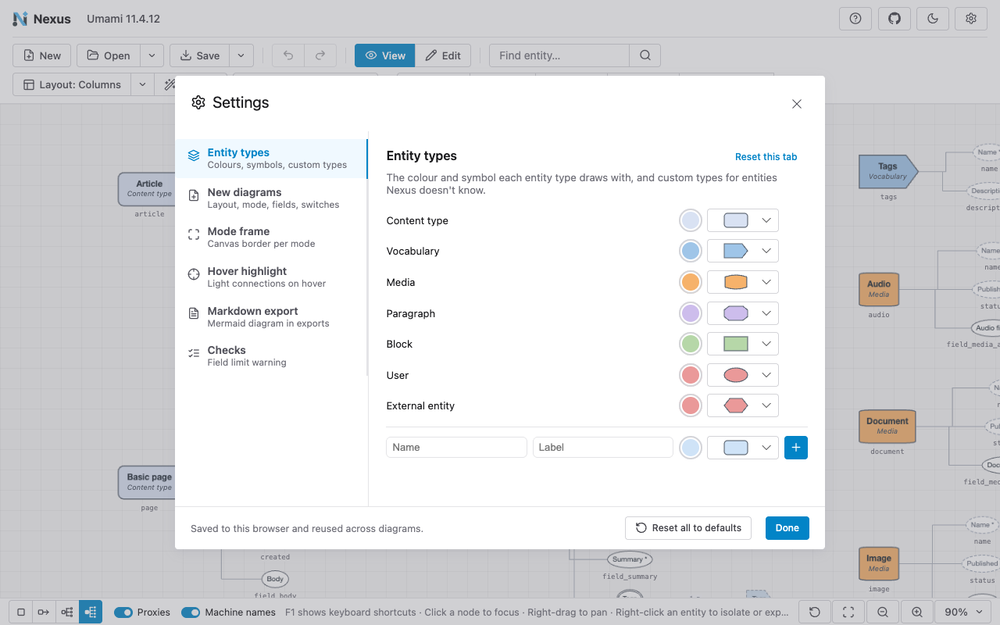

# Settings

The **Settings** dialog holds the preferences that apply to every diagram you open in your browser, from entity type colors to the Checks panel's field limit. This page covers each tab and every setting on it.

Click the cog button at the top right of the toolbar, or press `,`, to open **Settings**. The dialog lists its 6 tabs down the left side, each with a line on what it holds, and reopens on the tab you last used. Nexus saves each change to your browser straight away and uses it in every diagram you open there. Click **Done**, the **×** or press `Escape` to close the dialog.

Each tab has a **Reset this tab** button that restores the defaults of that tab only. **Reset all to defaults** at the foot of the dialog restores the defaults of every tab. Neither button removes your custom entity types or changes the line style.

## Entity types

The **Entity types** tab sets the color and symbol each entity type draws with, and holds your custom entity types. Each entity type has a row with its label, a color picker and a symbol list. The symbol list offers these shapes: **Rounded rectangle**, **Rectangle**, **Ellipse**, **Diamond**, **Hexagon**, **Tag**, **Barrel**, **Cut rectangle**, **Parallelogram**, **Pentagon** and **Octagon**.

The defaults follow the [visual language](visual-language.md): content types are rounded rectangles, vocabularies tags, media barrels, paragraphs cut rectangles, blocks rectangles, users ellipses and external entities hexagons. The canvas, the [Legend](legend.md), the **Add** bar and the exports pick up a change straight away.

A custom entity type stands for entities Nexus doesn't know, such as a commerce product. To add one:

1. In the last row, type a machine name in **Name**, such as `event_ticket`.
2. Optional: type a label in **Label**, such as `Event ticket`. Without one, Nexus makes a label from the machine name.
3. Pick a color and a symbol.
4. Click **+**.

Nexus turns the name into a machine name, and a name that's empty or that another type already has adds nothing. A custom type shows in the **Type** list of the new entity form, and a CSV import or a saved diagram can bring one with it. To remove a custom type, click **-** at the end of its row.

## New diagrams

The **New diagrams** tab sets what every new diagram opens with. It applies to a diagram you start, import or open from a file, a template, a link or an AI agent. A layout or detail level you pick in the toolbar lasts for the open diagram only.

| Setting | What it sets | Default |
|---------|--------------|---------|
| **Layout** | The [layout](layouts.md): **Left to right (LR)**, **Top to bottom (TB)** or **Columns** | **Columns** |
| **Mode** | **View** or **Edit** mode | **View** |
| **Fields** | The [detail level](navigating.md#detail-levels): **Entities**, **References**, **Configurable** or **All** | **All** |
| **Proxies** | Whether references draw as proxies beside their fields | On |
| **Machine names** | Whether each node shows its machine name | On |

A saved diagram opens at its own node positions, and the **Layout** button runs the layout set here.

## Mode frame

The **Mode frame** tab draws a colored frame inside the edge of the canvas, so you can tell at a glance which mode you're in. **View mode** and **Edit mode** each have a switch and a color picker. The color picker is off while its switch is off, and the preview under the rows shows how each frame draws.

By default, View mode has no frame and Edit mode has an orange one. The frame never shows in an export.

## Hover highlight

The **Hover highlight** tab has 1 switch, **Highlight connections**. When it's on, resting the pointer on a node lights up its fields, references and connected entities, and fades the rest. It's on by default. See [Moving around the canvas](navigating.md#hover-highlight).

## Markdown export

The **Markdown export** tab sets when **Save as** > **Markdown** starts the document with a Mermaid diagram of the model. Pick 1 of these in **Diagram**:

- **Up to 50 entities**, the default, adds the diagram to a model of up to 50 entities.
- **Always** adds it to every export.
- **Never** leaves it out.

See [Exporting](exporting.md#markdown).

## Checks

The **Checks** tab sets the limits the [Checks](checks.md) panel warns about. **Field limit** is the number of fields of its own a bundle can have before the panel warns about it. It takes a whole number from 1 to 999, and the default is 30.
