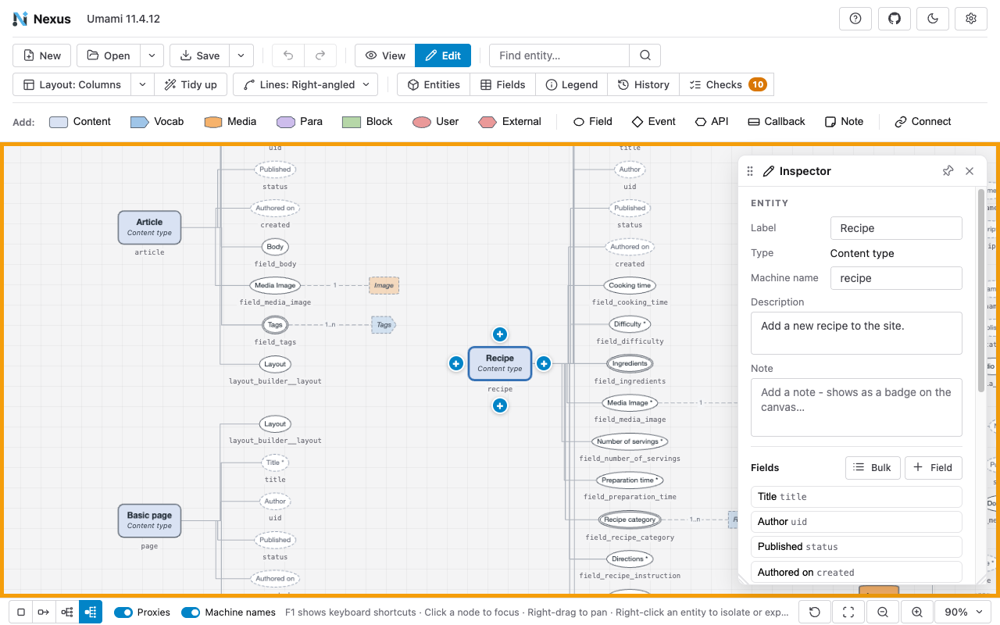

# View and Edit modes

Nexus has 2 modes: View mode for reading a diagram and Edit mode for changing it. This page covers what a click, a drag and a right-click do in each mode, and how to switch between them.

## Switch modes

Click **View** (`V`) or **Edit** (`E`) in the toolbar. A diagram opens in the mode set on the **New diagrams** tab of [Settings](settings.md#new-diagrams), which is View mode by default.

To jump from View mode into Edit mode on a node, double-click the node. Nexus switches to Edit mode and opens the node in the [Inspector](inspector.md).

A mode switch clears any focus, isolation or search highlight on the canvas.

## View mode

View mode leaves the diagram as it is, so you can click around freely:

- Click an entity to focus it. Nexus keeps the entity, its fields and the entities a reference links it to, fades the rest and centers the entity with its fields.
- Click a field to trace it. Nexus highlights the field, its entity and the entities it references, and fades the rest.
- Click a proxy, the faded copy of a reference's target, to focus the entity it stands for.
- Click the empty canvas to clear the focus.
- Rest the pointer on a node to see its tooltip and the [hover highlight](navigating.md#hover-highlight).

A left-drag on the canvas does nothing in View mode. A right-drag pans in either mode, as [Moving around the canvas](navigating.md) explains.

## Edit mode

Edit mode adds the **Add** bar under the toolbar, with a button for each kind of node you can create. [Building a model](building.md) covers each one.

In Edit mode, the left button selects and moves nodes:

- Click a node to select it and open it in the [Inspector](inspector.md). A selected entity gets a **+** handle on each side, and a click on a handle adds a field on that side.
- Hold `Shift`, `Ctrl` or `Cmd` and click another node to add it to the selection.
- Drag on the empty canvas to draw a box, and every node inside it is selected. A box that leaves out the node the Inspector shows closes the Inspector.
- Drag a node to move it. Dragging a selected node moves the whole selection, and each drag is 1 step in the [history](history.md).
- Click a proxy to open the entity it stands for.

Fields are what Edit mode edits, so switching to Edit mode at the **Entities** detail level moves the canvas to **All**. By default, an orange frame runs around the canvas in Edit mode. The **Mode frame** tab of [Settings](settings.md#mode-frame) changes it.

Edit mode is off while you [compare 2 versions](comparing.md) of a model.

## Isolate an entity

Right-click an entity, in either mode, to isolate it. Nexus fades everything but the entity, its fields and their proxies, and opens a menu at the pointer with **Explore from here**. That menu item starts the [explore view](explore.md).

While an entity is isolated in Edit mode, dragging any part of the group moves the whole group, and a faded node can't be moved. Click the empty canvas to end the isolation.

The menu closes when you press `Escape`, click outside it, pan, zoom or switch modes.
