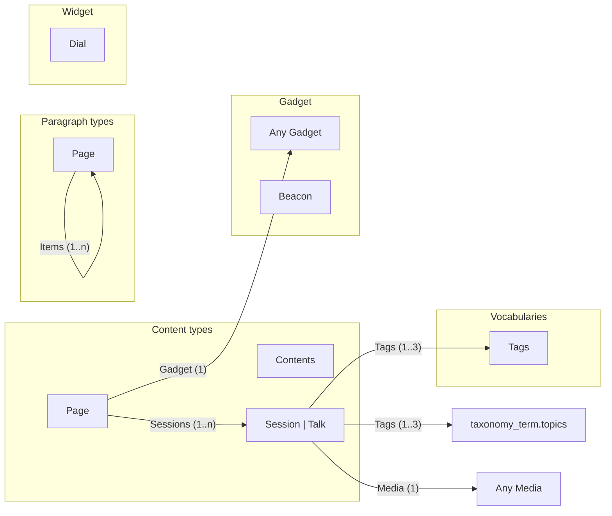

# Event site

## Contents

- [Diagram](#diagram)
- [Content types](#content-types)
  - [Contents](#contents-1)
  - [Page](#page)
  - [Session \| Talk](#session--talk)
- [Vocabularies](#vocabularies)
  - [Tags](#tags)
- [Paragraph types](#paragraph-types)
  - [Page](#page-1)
- [Gadget](#gadget)
  - [Any Gadget](#any-gadget)
  - [Beacon](#beacon)
- [Widget](#widget)
  - [Dial](#dial)

## Diagram

## Content types

### Contents

Machine name: `contents`

No fields.

### Page

Machine name: `page`

| Field | Machine name | Type | Cardinality | Required | References | Note |
| --- | --- | --- | --- | --- | --- | --- |
| Sessions | `field_sessions` | `entity_reference` | 1..n | Yes | [Session \| Talk](#session--talk) |  |
| Gadget | `field_gadget` | `entity_reference` | 1 | No | [Any Gadget](#any-gadget) |  |

### Session \| Talk

Machine name: `session`

> Talks and \*workshops\*. 
> \- Run on day 2
>
> 1\. Keep under 45 minutes

| Field | Machine name | Type | Cardinality | Required | References | Note |
| --- | --- | --- | --- | --- | --- | --- |
| Title (base field) | `title` | `string` | 1 | Yes |  |  |
| Tags | `field_tags` | `entity_reference` | 1..3 | No | [Tags](#tags), `taxonomy_term.topics` | Pick \`up to\` 3. Use \$ prices & \<b\>bold\</b\> sparingly. |
| Media | `field_media` | `entity_reference` | 1 | No | Any Media |  |
| Pipe name | `field_a\|b` | `string` | 1 | No |  |  |

Referenced by: Sessions on [Page](#page).

## Vocabularies

### Tags

Machine name: `tags`

| Field | Machine name | Type | Cardinality | Required | References | Note |
| --- | --- | --- | --- | --- | --- | --- |
| Name (base field) | `name` | `string` | 1 | Yes |  |  |

Referenced by: Tags on [Session \| Talk](#session--talk).

## Paragraph types

### Page

Machine name: `page`

| Field | Machine name | Type | Cardinality | Required | References | Note |
| --- | --- | --- | --- | --- | --- | --- |
| Items | `field_items` | `entity_reference_revisions` | 1..n | No | [Page](#page-1) |  |

Referenced by: Items on [Page](#page-1).

## Gadget

### Any Gadget

Machine name: `*`

No fields.

Referenced by: Gadget on [Page](#page).

### Beacon

Machine name: `beacon`

No fields.

## Widget

### Dial

Machine name: `dial`

No fields.
